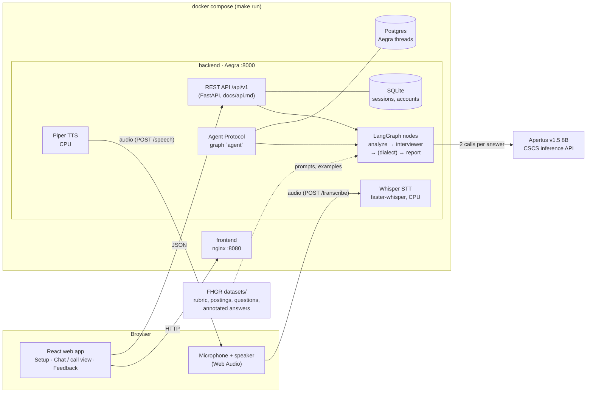

# Architecture

Everything below the browser runs in Docker on one machine (`make run`). The only external service is the
CSCS endpoint that serves Apertus v1.5 8B.



## One answer, step by step

```mermaid
sequenceDiagram
    participant C as Candidate (browser)
    participant API as REST API
    participant G as LangGraph
    participant A as Apertus 8B

    C->>API: POST /sessions/{id}/answers (typed, or text from POST /transcribe)
    API->>G: answer + interview state
    G->>G: guardrails (crisis, manipulation) in code
    G->>A: call 1: analysis (11 criteria 1-4 or null, tip, flags) as JSON
    A-->>G: scores, short tip, follow-up?
    G->>G: phase logic in code: follow-up or next question
    G->>A: call 2: interviewer (next question, in the posting's persona)
    A-->>G: question
    opt Mundart
        G->>A: call 3: Standard German → dialect (with examples)
    end
    G-->>API: next question, tip (training mode), progress
    API-->>C: JSON; in hands-free mode the question is read aloud (POST /speech)
```
